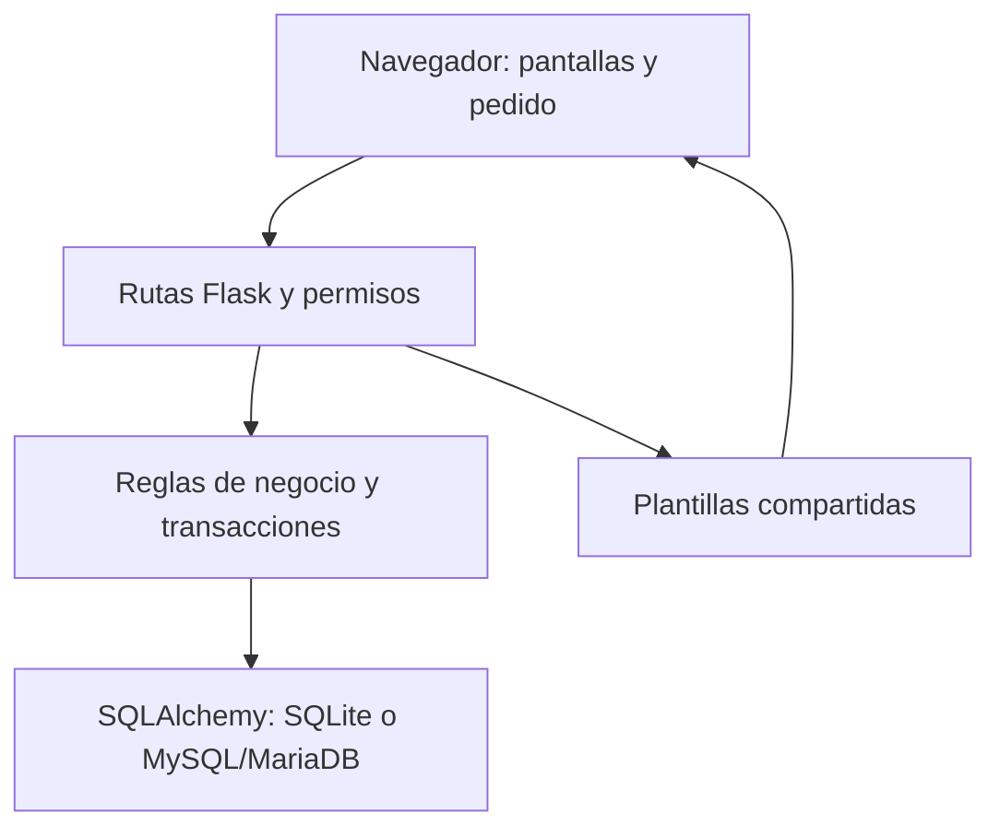

# Ingeniería de Software II · Base técnica del proyecto

## Problema y resultado

La versión original podía registrar parcialmente una venta con varios artículos, aceptar importes
enviados desde el navegador y generar un comprobante que mostraba solo un artículo. Esta versión
registra una cabecera con sus detalles, valida cantidades y precios y confirma o revierte todos los cambios.

## Arquitectura

Aplicación web con renderizado de plantillas y API JSON para el catálogo, consulta de clientes y ventas.
Las reglas de negocio se separan de las rutas. Los modelos usan un motor configurable.

| Componente | Responsabilidad |
|---|---|
| `app.py` | Entrada de desarrollo y opción de demo |
| `olam/__init__.py` | Fábrica de aplicación, configuración, sesiones, CSRF, filtros y conexión |
| `olam/routes.py` | Autenticación, permisos, formularios y endpoints |
| `olam/services.py` | Reglas de validación, ventas, canjes, anulaciones y auditoría |
| `olam/models.py` | Modelo relacional y restricciones |
| `olam/templates` | Presentación común y pantallas por tarea |
| `olam/static` | CSS, comportamiento JavaScript e ilustraciones locales |
| `tests` | Pruebas temporales de operaciones, permisos, concurrencia, formularios y DOM |

## Requisitos y criterios de aceptación

| ID | Requisito | Criterio observable | Verificación |
|---|---|---|---|
| RF01 | Acceso por rol | Caja no modifica stock ni usuarios; almacén no consulta clientes | Pruebas GET y POST por rol |
| RF02 | Venta de varios productos | Un comprobante contiene todos los artículos | Venta mixta y revisión del HTML |
| RF03 | Inventario coherente | No queda stock negativo ni descuento parcial | Falta de stock y ventas concurrentes |
| RF04 | Fidelización | Saldo aumenta por venta y disminuye con canje | Pruebas de saldo y canje |
| RF05 | Anulación | Revierte una sola vez y conserva el documento | Pruebas de anulación repetida |
| RF06 | CRUD mantenible | Altas y edición; desactivar conserva referencias | Pruebas de clientes y usuarios; registro de cambios |
| RF07 | Historia de cambios | Cada cambio de inventario tiene autor y motivo | Registros de movimientos y auditoría |
| RF08 | Reintento seguro | Repetir una confirmación devuelve la misma venta | UUID y huella; prueba de doble envío |
| RNF01 | Integridad | Error en cualquier detalle revierte toda la operación | Transacción y prueba de rollback |
| RNF02 | Seguridad de acceso | Hash de contraseña, CSRF y sesiones revocables | Pruebas de autenticación, token y revocación |
| RNF03 | Usabilidad | Tareas principales con mensajes claros y posibilidad de corregir | DOM automatizado; validación humana pendiente |
| RNF04 | Mantenibilidad | Presentación, rutas, reglas y datos separados | Revisión de estructura y pruebas reutilizables |
| RNF05 | Portabilidad | SQLite local; MySQL por variable de entorno | SQLite probado; DDL MySQL compilado, conexión real pendiente |
| RNF06 | Rendimiento | Listados paginados y consultas indexadas por fecha | Sin pruebas de carga ni SLA afirmado |
| RNF07 | Accesibilidad | Etiquetas, teclado nativo, foco y estados semánticos | Revisión automática parcial; auditoría completa pendiente |

## Verificación y validación

Verificar: comprobar reglas, permisos, transacciones y datos contra los requisitos.
Validar: observar si usuarios reales pueden realizar sus tareas y si el sistema resuelve su necesidad.
Las pruebas automáticas de esta entrega son principalmente verificación. No reemplazan aceptación del negocio.

Niveles: las funciones de reglas se ejercitan mediante pruebas de integración con base temporal; los
formularios se prueban a través del cliente HTTP de Flask; JavaScript se ejercita con DOM simulado.
No se realizaron pruebas completas de extremo a extremo en navegador real en este entorno.

## Configuración y control de cambios

| Elemento | Control |
|---|---|
| Línea base | Etiqueta `v1.0.0-original` |
| Versión mejorada | Etiqueta `v2.0.0` |
| Código y documentación | Git y bundle transportable |
| Dependencias | Versiones fijadas de Flask, SQLAlchemy, PyMySQL y pruebas; lock para pruebas JS |
| Datos y claves | Fuera del repositorio; respaldo separado |
| Incidencia crítica inicial | Venta parcial y comprobante incompleto |
| Impacto | Cabecera/detalle, carrito, inventario y puntos; pruebas de regresión |
| Cierre de cambio | Revisión del código, pruebas y etiqueta de versión |

Procedimiento para siguientes cambios: describir el problema → identificar módulos y datos afectados →
definir aceptación → implementar en una rama → ejecutar pruebas pertinentes → revisar → documentar y versionar.
No se inventa un sprint ejecutado ni roles Scrum de personas que no participaron en este trabajo.

## Relación con los contenidos del curso

| Unidad / semanas | Aplicación en la entrega |
|---|---|
| 1–4: requisitos, arquitectura y calidad | Contexto, separación de componentes y requisitos observables |
| 5–8: pruebas, verificación, validación y calidad | Casos positivos/negativos, permisos, concurrencia y registro de límites |
| 9–12: configuración y cambios | Línea base, historial, dependencias, cambio de esquema y plan de respaldo |
| 13–14: estándares y SWEBOK | Trazabilidad de requisitos, pruebas y configuración como prácticas relacionadas; sin certificación |
| 15: métodos ágiles | Backlog priorizado, aceptación e iteración; falta coordinar el equipo y registrar trabajo real |
| 16: despliegue | Inicio local, guía de WSGI, configuración y recuperación; producción no desplegada |

Las familias ISO/IEC del sílabo se emplean como marco de análisis académico. Aplicar algunas prácticas
no permite declarar conformidad o certificación ISO/IEC 12207, 25000 o 25010. ISO/IEC 9126 y 14598
figuran en el sílabo como antecedentes; no se presentan como versiones actuales de certificación.

## Backlog restante con evidencia necesaria

| Prioridad | Trabajo | Criterio de cierre |
|---|---|---|
| Alta | Prueba visual en Chrome/Edge del equipo del estudiante | Menús, diálogos, impresión y controles correctos |
| Alta | Validar política de puntos con el negocio | Regla acordada y ejemplos aprobados |
| Alta | Probar la base MySQL real en copia | Pruebas de venta, canje, concurrencia y respaldo pasan allí |
| Alta | Investigación y pruebas de usuarios | Registro de tareas y hallazgos reales |
| Media | Auditoría WCAG completa | Resultados manuales, lector de pantalla, contraste y móvil |
| Media | Migración de registros anteriores, si se requiere | Conciliación y preservación de históricos |
| Media | Carga, monitoreo y despliegue | Requisitos cuantificados y mediciones en el servidor destino |

Fuentes técnicas: https://flask.palletsprojects.com/en/stable/web-security/ y
https://docs.sqlalchemy.org/en/20/tutorial/dbapi_transactions.html .
